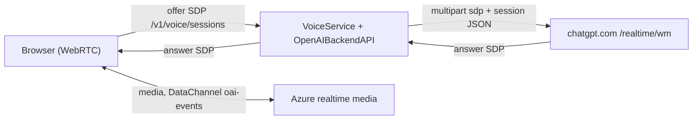

# Voice Architecture

Status: current

The voice gateway from `chatgpt-web-voice` (Go, MIT) is ported into
this Python project as a single process (ADR
[0005](adr/0005-merge-voice-gateway-into-python.md), Scheme A). The
standalone Go deployment on port 8090 retires once the merged
deployment is verified.

## Boundary

Signalling goes through the gateway; media goes browser-to-Azure
direct. The gateway never receives or stores raw call audio, image
bytes, or `file_id` values. Voice calls enter Logs/Monitor as
metadata only (`voice_session_id`, account id, voice parameters,
duration, outcome). SDP bodies, ICE candidates, and DataChannel text
are never logged.

## Call flow

1. Browser reads `GET /v1/voice/config` (9 voices, defaults
   `cove` / `wingman` / `auto`, STUN `stun.l.google.com:19302`,
   negotiated DataChannel `"oai-events"` id 0).
2. Browser creates the offer and posts it to
   `POST /v1/voice/sessions` with `voice` / `voice_mode` /
   `language_code`.
3. `VoiceService.create_session` picks an account, posts the offer to
   `POST https://chatgpt.com/realtime/wm?dcid=0` (multipart parts
   `sdp` and `session` JSON; `backend_reasoning_effort` `"instant"`,
   `model_slug` `""`), and returns the answer SDP text (`v=0`).
4. During the call the browser reports upstream continuity via
   `POST /v1/voice/sessions/{id}/context`.
   Finalized subtitles are persisted with
   `POST /v1/voice/sessions/{id}/messages`
   (`conversation_id` is the upstream conversation id; the backend
   resolves it to the local `voice_conversations` row before writing
   `voice_messages`). In-call image upload was removed on 2026-11-16:
   the voice path does not support sending images mid-call (the model
   cannot see them), so the `/uploads` credential/complete routes, the
   gateway upload methods, and the panel button were all deleted.
5. Hangup calls `DELETE /v1/voice/sessions/{id}`; the title can be
   fetched with `GET /v1/voice/sessions/{id}/title`.

## Sticky accounts

A `voice_session_id` is pinned to one Upstream Account: the
`conversation_id` only works for the account that created it.
`AccountService.get_voice_access_token(preferred_account_id,
excluded)` pins by management id when given, otherwise picks the
least-recently-used usable account. On upstream 401 the account is
marked invalid (`mark_voice_token_invalid` ->
`handle_invalid_token`) and a non-sticky call retries with another
account (at most `voice.max_account_attempts`, default 4); a sticky
account failure fails directly with 401/503 and never silently
switches. Voice accounts get RT auto-refresh through
`ensure_access_token`, unlike the Go gateway which never refreshed.

## Authentication

Voice routes reuse the chatgpt2api User Key system only: Bearer
token, `auth_service` verification, SHA-256 hash,
`admin_console` / `studio` capabilities, via `api/support.py`
`require_identity` (`require_admin` for `GET /api/voice/sessions`).
The Go gateway's `vgw_live_*` downstream keys are abandoned
entirely: not retained, not compatible, not migrated, with no
compatibility code anywhere. Its admin username/password login is
likewise gone.

## Ownership

| Concern | Owner |
| --- | --- |
| Voice projections (config, session, error shapes) | `contracts/voice.py` |
| Bindings (process memory, TTL 180s), retry, context, title, release | `services/voice_service.py` |
| Voice session/conversation/message metadata | `services/storage/voice_session_repository.py` (`voice_sessions`, `voice_conversations`, `voice_messages` in the Application Database) |
| Sticky selection, invalid marking, RT refresh | `AccountService.get_voice_access_token` / `mark_voice_token_invalid` |
| Upstream wm / settings-user / conversation calls | `OpenAIBackendAPI` voice methods |
| HTTP auth, status codes, `LoggedCall` metadata | `api/voice.py` |
| Voice tunables (default voice/language, session TTL, max attempts) | Settings system (`voice.*`), not environment variables |

## Known unverified item

Whether `/realtime/wm` accepts curl-cffi `chrome110`
impersonation is unverified: it needs a live test with a real
ChatGPT account. If it fails, the fallback is Scheme B (Go sidecar)
or a different impersonate configuration (ADR 0005).
